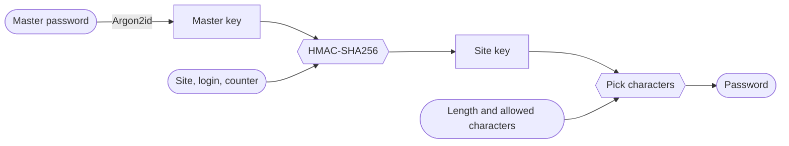

<p align="center">
  
</p>

<h1 align="center">Rune</h1>

<p align="center">
  <b>A deterministic password generator for Linux.</b><br />
  One master password becomes a different password for every site. No password is ever stored.
</p>

<p align="center">
  Pairs with <a href="https://github.com/BassamAlim/rune-android"><b>Rune for Android</b></a>: the same passwords on your phone, synced over Wi-Fi.
</p>

<p align="center">
  <a href="https://github.com/BassamAlim/rune-desktop/actions/workflows/ci.yml"></a>
  <a href="LICENSE"></a>
  
</p>


<sub>Rendered from the app's own screens by its screenshot test.</sub>

The Android app is in [`rune-android`](https://github.com/BassamAlim/rune-android) and produces
the same passwords. [`SPEC.md`](SPEC.md) is the contract for both apps; `vectors.json` is the
shared test data.

## How it works



There is no vault to sync, back up or leak: the same master password and site name give the
same password on every device. Only the list of site names and their settings is kept, and it
holds no secrets. The whole algorithm, `rune/v1`, is in [`SPEC.md` §2](SPEC.md#2-algorithm-runev1).

## Features

- **Nothing to steal.** Passwords are worked out from your master password and the site's
  name. They are never written to disk, and the master key isn't kept on this computer at all.
- **Approved on your phone.** Showing a password asks Rune on your phone, which shows the same
  six-digit code and asks for your fingerprint. Without the phone, type the master password
  instead; it's used once and forgotten.
- **Syncs with your phone over Wi-Fi.** No server and no account: the two devices find each
  other on your network and exchange the site list, encrypted with a key only your master
  password gives.
- **Sites.** A searchable list of site names and logins. Two logins on one site get two
  different passwords.
- **Per-site settings.** Length, which kinds of character, and a counter you raise to get a
  new password for that site.
- **Careful copy.** A copied password is kept out of clipboard history and cleared after 30
  seconds if it is still on the clipboard.
- **Same passwords on your phone.** Set both apps up with the same master password; the
  four-character fingerprint shows they match.
- **Export and import.** The site list is one JSON file, shared with the Android app.
- **Move in from Bitwarden.** Import its unencrypted `.json` export and every login keeps its
  password, sealed by your phone, until you change it to Rune's.

## Install

There are no packaged releases yet; build it from source. You need a stable Rust toolchain
(1.85 or newer) and nothing else to build.

```bash
git clone https://github.com/BassamAlim/rune-desktop
cd rune-desktop
scripts/install.sh              # binary, launcher entry and icon into ~/.local
```

Rune has only been tested on KDE Plasma (Wayland, Fedora). It should run on other desktops,
but the keyring, keeping passwords out of clipboard history, and the launcher icon are the
parts most likely to behave differently there; reports are welcome.

At run time Rune needs a Secret Service keyring (KWallet or GNOME Keyring). Fingerprint unlock
uses `fprintd` when it is there, and falls back to the master password when it isn't.
A prebuilt binary of every commit on `main` is attached to its
[CI run](https://github.com/BassamAlim/rune-desktop/actions/workflows/ci.yml).

## Before you rely on it

Rune was written for one person and has had no outside security review. Read
[`SPEC.md` §8](SPEC.md#8-known-limits) first; the short version:

- Forgetting the master password loses every password. Nothing can recover it.
- Someone who gets one of your site passwords can guess your master password offline. The
  generated six-word passphrase is out of reach; a weak password of your own is not, and the
  key derivation has no per-user salt to slow an attacker working on many users at once.
- Malware running as you on the desktop sees every password you ask for while it is there.

## Development

```
crates/rune-core/      the rune/v1 algorithm and the site list (no UI, no keyring)
crates/rune-desktop/   the egui app: main.rs (screens), theme.rs (look), store.rs (keyring, clipboard,
                       sync and approvals from the phone)
assets/                logo, in-app mark, fonts, launcher entry
scripts/mark/          the mark and the generator for every logo asset, Android included
scripts/install.sh     build a release binary and install it for the current user
```

```bash
cargo run                       # run the app
cargo test --workspace          # all tests
```

Three tests are ignored by default because they touch the real machine:

```bash
cargo test -p rune-desktop -- --ignored screenshots   # render every screen to target/screenshots/
cargo test -p rune-desktop -- --ignored keyring       # write and delete a test entry in the keyring
cargo test -p rune-desktop -- --ignored clipboard     # overwrites the clipboard
```

### Where things are kept

- Keys: the Secret Service keyring, service `rune`, account `keys`: the sync key and
  fingerprint only, never the master key. Rune opens behind your fingerprint (or master
  password) and locks after 5 idle minutes; that hides the list on screen, nothing more.
- Site list: `~/.local/share/rune/sites.json`. It holds names and settings, never passwords.

### Changing the algorithm

Don't, without bumping `rune/v1` to `rune/v2` in the derivation: every existing password would
change. If you do, regenerate the vectors and copy them to the Android repo:

```bash
cargo run -p rune-core --example gen-vectors > vectors.json
```

## License

Rune is free software under the [GNU General Public License v3.0](LICENSE).

It ships with work by others under their own licenses:

- [Space Grotesk](https://github.com/floriankarsten/space-grotesk) and
  [JetBrains Mono](https://github.com/JetBrains/JetBrainsMono), under the SIL Open Font License
  1.1 ([`licenses/`](licenses)).
- The [EFF large wordlist](https://www.eff.org/dice) (`crates/rune-core/words.txt`), by the
  Electronic Frontier Foundation, under [CC BY 3.0 US](https://creativecommons.org/licenses/by/3.0/us/).
