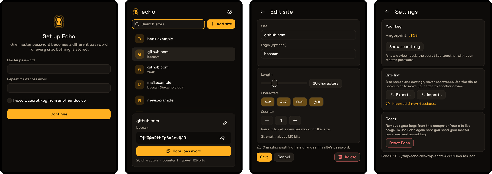

<p align="center">
  
</p>

<h1 align="center">Echo</h1>

<p align="center">
  <b>A deterministic password generator for Linux.</b><br />
  One master password and a secret key become a different password for every site. No password is ever stored.
</p>



<sub>Rendered from the app's own screens by its screenshot test.</sub>

The Android app is in [`echo-android`](https://github.com/BassamAlim/echo-android) and produces
the same passwords. `SPEC.md` is the contract for both apps; `vectors.json` is the shared test
data.

## Features

- **Nothing to steal.** Passwords are worked out from your master password, a secret key held
  on the device, and the site's name. They are never written to disk.
- **Sites.** A searchable list of site names and logins. Two logins on one site get two
  different passwords.
- **Per-site settings.** Length, which kinds of character, and a counter you raise to get a
  new password for that site.
- **Careful copy.** A copied password is kept out of clipboard history and cleared after 30
  seconds if it is still on the clipboard.
- **Same passwords on your phone.** Set both apps up with the same master password and secret
  key; the four-character fingerprint shows they match.
- **Export and import.** The site list is one JSON file, shared with the Android app.

## Layout

```
crates/echo-core/      the echo/v1 algorithm and the site list (no UI, no keyring)
crates/echo-desktop/   the egui app: main.rs (screens), theme.rs (look), store.rs (keyring, clipboard)
assets/                logo, in-app mark, fonts, launcher entry
scripts/mark/          the mark's geometry and the generator for every logo asset, Android included
scripts/install.sh     build a release binary and install it for the current user
```

## Commands

```bash
cargo run                       # run the app
cargo test --workspace          # all tests
scripts/install.sh              # install binary, launcher entry and icon into ~/.local
```

Three tests are ignored by default because they touch the real machine:

```bash
cargo test -p echo-desktop -- --ignored screenshots   # render every screen to target/screenshots/
cargo test -p echo-desktop -- --ignored keyring       # write and delete a test entry in the keyring
cargo test -p echo-desktop -- --ignored clipboard     # overwrites the clipboard
```

## Where things are kept

- Keys: the Secret Service keyring (KWallet), service `echo`, account `keys`. Anyone at your
  unlocked desktop session can open Echo; the keyring is the lock.
- Site list: `~/.local/share/echo/sites.json`. It holds names and settings, never passwords.

## Changing the algorithm

Don't, without bumping `echo/v1` to `echo/v2` in the derivation: every existing password would
change. If you do, regenerate the vectors and copy them to the Android repo:

```bash
cargo run -p echo-core --example gen-vectors > vectors.json
```
